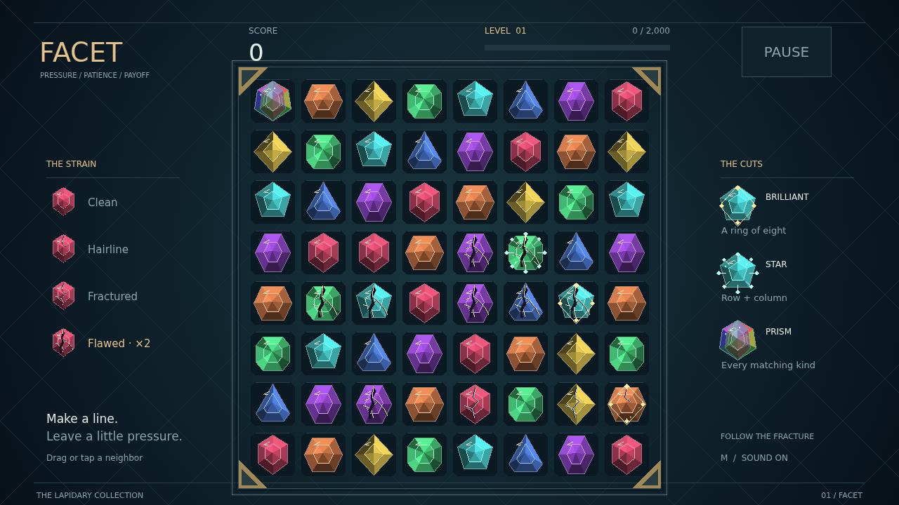

# Facet

A quiet board. A bright stone. A little pressure in exactly the right place. Facet is a gem puzzle where every match leaves something behind: strain in the stones that survive.

Swap neighboring gems into lines of three or more and watch them fracture. Fresh stones drop into the gaps, and a new match can turn one move into a climbing chain. Each step is worth more than the last.

Watch the cracks. A worn stone eventually becomes flawed, ready to break with any clear beside it and worth twice the points. Build pressure along a corner, then spend it in a shattering wave across the bench.

Longer lines leave precious cuts. A brilliant takes the ring around it; a star reaches along its whole row and column. A prism trades its many-colored light for every stone of one kind. Reach the target, collect your best move and longest chain, and face a fresh level. Keep finding the flaw until no move remains.

